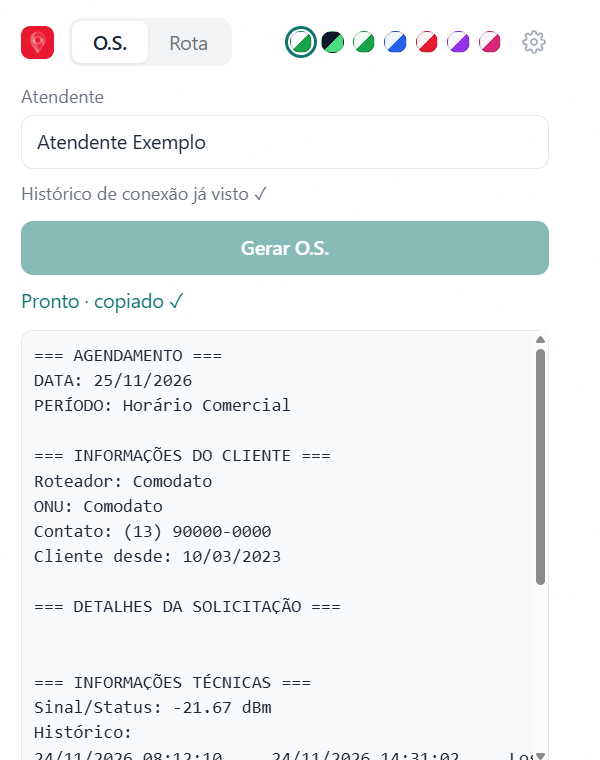
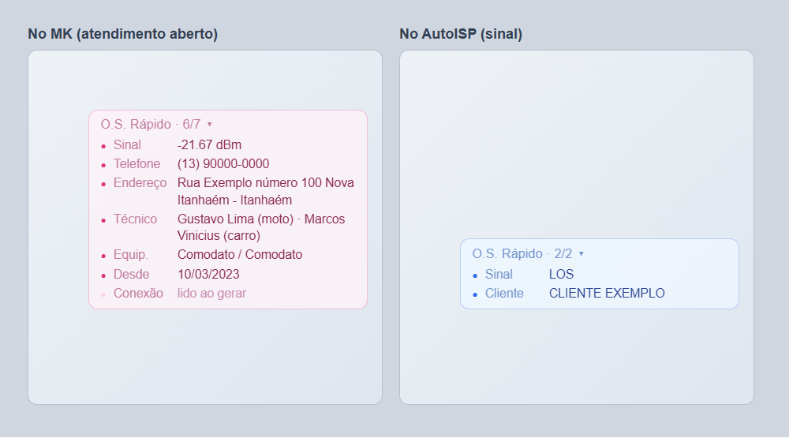
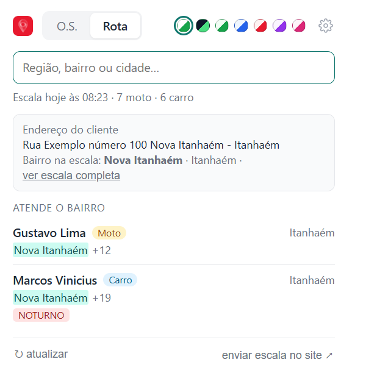
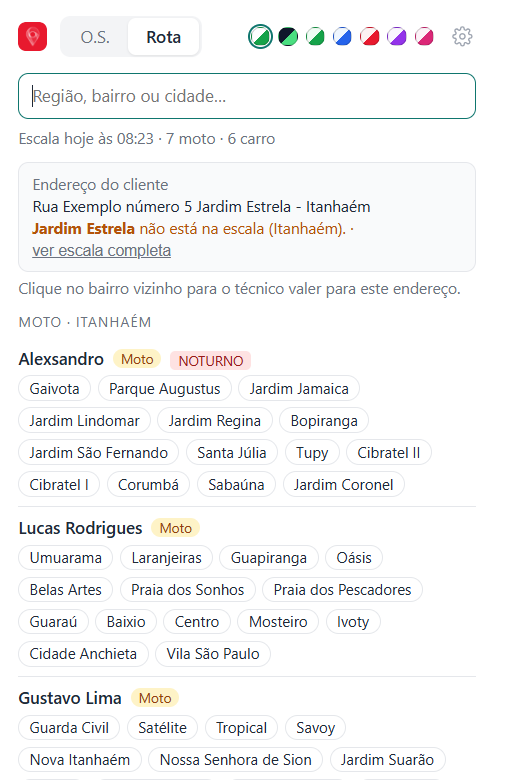
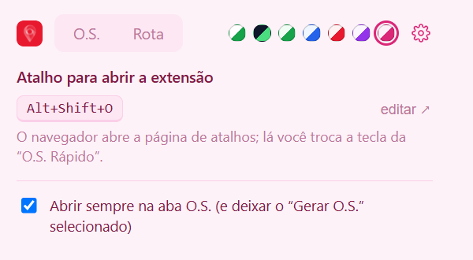

# O.S. Rápido

Extensão para o navegador que **monta o texto da O.S. sozinha** a partir do atendimento aberto no MK e mostra **qual técnico atende o endereço do cliente**, usando a escala do dia.

> Dados dos prints são de exemplo.

---

## Como funciona

1. **Abra o atendimento no MK.** A extensão lê em segundo plano e mostra um checklist no canto da tela.
2. **Clique no ícone (ou `Alt+Shift+O`) → Gerar O.S.** O texto sai pronto e já copiado.
3. **Cole no bloco de notas.**

---

## 1. Gerar O.S.

- Texto no seu modelo: agendamento, cliente, histórico de quedas, atendente.
- Salva sozinho o que você edita. **Limpar** pede confirmação.

## 2. Checklist ao vivo

- Mostra o que já foi lido: sinal, telefone, endereço, técnico, roteador/ONU, histórico.
- No **AutoISP**, lê o sinal e identifica **LOS** e **Sem energia**.
- Arrastável, minimizável e com 7 cores.

## 3. Rota: técnico pelo endereço

- Lê o endereço do cadastro e acha o bairro na escala do dia.
- A escala vem do mesmo banco do site de O.S., sempre atualizada.

## 4. Bairro fora da escala

- Mostra os técnicos da cidade (moto e carro) com as regiões de cada um.
- Um clique no bairro vizinho e a escolha fica **salva** para os próximos.

## 5. Configurações

- Atalho de teclado editável (`Alt+Shift+O` por padrão).
- A cor escolhida pinta o checklist **e** a extensão.

---

## O que ela lê

| Dado | De onde |
|---|---|
| Telefone, endereço, roteador/ONU, cliente desde | Atendimento no MK |
| Histórico de conexão (quedas) | Aba da prancheta do MK |
| Sinal e status (LOS / Sem energia) | AutoISP |
| Técnico por bairro | Escala do site de O.S. |

## Instalação

Chrome, Edge, Opera, Brave e Vivaldi: página de extensões → **Modo do desenvolvedor** → **Carregar sem compactação** → pasta `extensao`.
Detalhes e Firefox: `LEIA-ME.md`.
